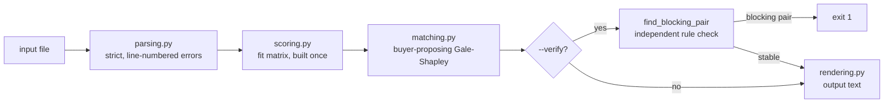

# pearl: stable neighborhood placement by certification fit

Home buyers moving to Charlottesville are placed into neighborhoods by how well their energy (E), water
(W) and resilience (R) goals match each neighborhood's certification scores. Each buyer's own ranking of
the neighborhoods applies, and buyers are split evenly across the neighborhoods. Text goes in and text
comes out, using only the standard library. The constraint is the interesting part. Once everyone is
housed, no buyer may be able to move somewhere they prefer *and* out-fit someone already living there.
That is the stable-matching condition: this program guarantees it and can re-check it on every run.

## A whole run

```
$ head -5 input.txt
N N0 E:7 W:7 R:10
N N1 E:2 W:1 R:1
N N2 E:7 W:6 R:4
H H0 E:3 W:9 R:2 N2>N0>N1
H H1 E:4 W:3 R:7 N0>N2>N1

$ python main.py --verify
verified: stable placement of 12 buyers across 3 neighborhoods
wrote generated_output.txt

$ cat generated_output.txt
N0: H5(161) H11(154) H2(128) H4(122)
N1: H9(23) H8(21) H7(20) H1(18)
N2: H6(128) H3(120) H10(86) H0(83)
```

Twelve buyers, three neighborhoods, four slots each. **H0** got its first choice, N2, scoring
`3·7 + 9·6 + 2·4 = 83`. That is the weakest fit there, kept only because no better-fitting buyer who
preferred N2 was still looking. **H1** also led with N0 but scores 119 there, below all four who stayed,
so it was rejected. It tried N2 (74, again below all four) and ended in N1, its last choice, at 18. One
rejection cascades into the next, and that cascade is the whole algorithm.

`input.txt` and `generated_output.txt` are the shipped sample pair; the tests pin that exact output.
[docs/example-run.txt](docs/example-run.txt) has the full transcript, including a second input with
named neighborhoods and an uneven split (thirteen buyers over four neighborhoods, capacities 4/3/3/3),
a parse error, and a buyer left unplaced by a partial preference list.

## Running it

Python 3.10 or newer, with nothing to install. `.python-version` pins 3.12, the version the Docker
images and the recorded runs use.

```bash
git clone <repository-url> pearl-certification-assessment
cd pearl-certification-assessment
python main.py                     # input.txt -> generated_output.txt
python main.py --stdout --verify   # print instead, re-checking stability first
python main.py data/example-input.txt --stdout
```

Or with Docker only. The runtime image is a non-root, read-only container whose default command places
the bundled input and verifies it:

```bash
docker compose run --rm pearl                                    # bundled input.txt
docker compose run --rm pearl /data/example-input.txt --stdout   # ./data is mounted read-only
docker compose --profile test run --rm tests                     # the test suite
```

Besides the input path there are four flags: `-o/--output`, `--stdout`, `--scorer` and `--verify`
(`--help` describes them). There are no env vars and no config file, so a run is fully described by the
command that produced it.

| exit code | meaning |
| ---: | --- |
| `0` | placed (and verified, with `--verify`) |
| `1` | the result failed `--verify` |
| `2` | input missing, not UTF-8 or unparseable, or the output file can't be written |

Parse errors name the line and quote it (`line 1: expected 5 fields, got 4 in 'N N0 E:1 W:1'`).
Input is one record per line, with `#` comments and blank lines skipped, integers only and unique names:

```
N <name> E:<int> W:<int> R:<int>
H <name> E:<int> W:<int> R:<int> <pref>><pref>><pref>
```

The output is one line per neighborhood in input order, buyers by fit (highest first), each with the
fit score that placed them.

## How a run flows



`--scorer` picks the fit function. Only `dot`, the dot product of goals and scores, is registered, but
`scoring.py` keeps a `Scorer` protocol and a registry, so adding an alternative needs no change to the
matching code.

## Why Gale-Shapley, and what it replaced

Neighborhoods are hospitals, an even share of buyers is capacity, and fit score is how a neighborhood
ranks buyers. That makes this the hospitals/residents problem, and buyer-proposing Gale-Shapley solves it
exactly. It terminates, it places every buyer who ranks every neighborhood, and of all stable assignments
it returns the one best for the buyers.

Before that, `assign` was a single greedy sweep. It visited each neighborhood once, took the buyers who
ranked it first and rehomed the overflow. With no way to revisit a neighborhood already decided, a buyer
displaced late could never compete for one settled early; the H1 cascade above is exactly what it could
not do. Over 60 generated inputs at three neighborhoods and twelve buyers it left a blocking pair on 18,
and at five neighborhoods and twenty buyers on 53 of 60. It was still correct on the one shipped input,
which is why the suite generates inputs instead of trusting a golden file. Its failing shapes are pinned
as `REGRESSION` in `tests/test_matching.py`.

The rule itself is checked, not assumed. `find_blocking_pair` restates it as code and knows nothing about
Gale-Shapley. It walks each buyer's preferences above their current placement, looking for a free slot or
a resident they out-fit. Tests assert against *that* rather than against expected output, and `--verify`
runs it.

## Tests

There are 309 tests, most of them one property repeated: 84 inputs generated from seven
neighborhood/buyer shapes × twelve seeds, each checked three ways (stable, every buyer placed once, every
capacity exact). The rest cover parsing, rendering, the scorer registry, CLI exit codes and I/O errors,
more neighborhoods than buyers, unplaced-buyer reporting, the five regression shapes, and the golden
answer for the shipped input.

```bash
pip install -r requirements-dev.txt   # pytest 9.2.0, ruff 0.17.4
python -m pytest
ruff check . && ruff format --check .
```

See [docs/test-run.txt](docs/test-run.txt) for the output. The Docker `test` stage runs the same three
commands, so the image doesn't build unless they pass.

## Where the time goes

Ranking buyers within each neighborhood is `O(M·N log N)` and dominates the `O(N·M)` proposals, each a
dict lookup into a fit matrix built once up front. `python scripts/benchmark.py`, on Python 3.12 in the
`python:3.12-slim` image ([docs/benchmark.txt](docs/benchmark.txt)):

| neighborhoods | buyers | parse | assign | verify |
| ---: | ---: | ---: | ---: | ---: |
| 3 | 12 | 0.000s | 0.000s | 0.000s |
| 10 | 1,000 | 0.003s | 0.009s | 0.007s |
| 25 | 10,000 | 0.050s | 0.317s | 0.284s |
| 50 | 50,000 | 0.430s | 4.932s | 4.330s |

The last two columns owe their shape to measuring. The stability check first rescanned the assignment
for every buyer, which made it quadratic and dominant past ten thousand buyers. Each neighborhood now
also holds its residents in a rank-keyed heap, so a displacement costs `O(log capacity)` rather than a
scan.

## Limits and choices

- **A file in, a file out.** There is no UI, API, database or persistence. The evidence is captured
  terminal output under `docs/`.
- **A partial preference list can leave a buyer unplaced** rather than forcing them somewhere they did
  not rank. They are named on stderr and left out of the output. Capacity remainders go to the earliest
  neighborhoods, so an inexact split never drops anyone. With fewer buyers than neighborhoods, the
  trailing neighborhoods get capacity 0 and stay empty.
- **Ties break by buyer name.** This is arbitrary but deterministic, so the same input always gives
  byte-identical output. A real product would want a defensible rule.
- **One process, in memory, integer scores only.** The parser rejects decimals, as the format specifies.

## License

MIT; see [LICENSE](LICENSE).
